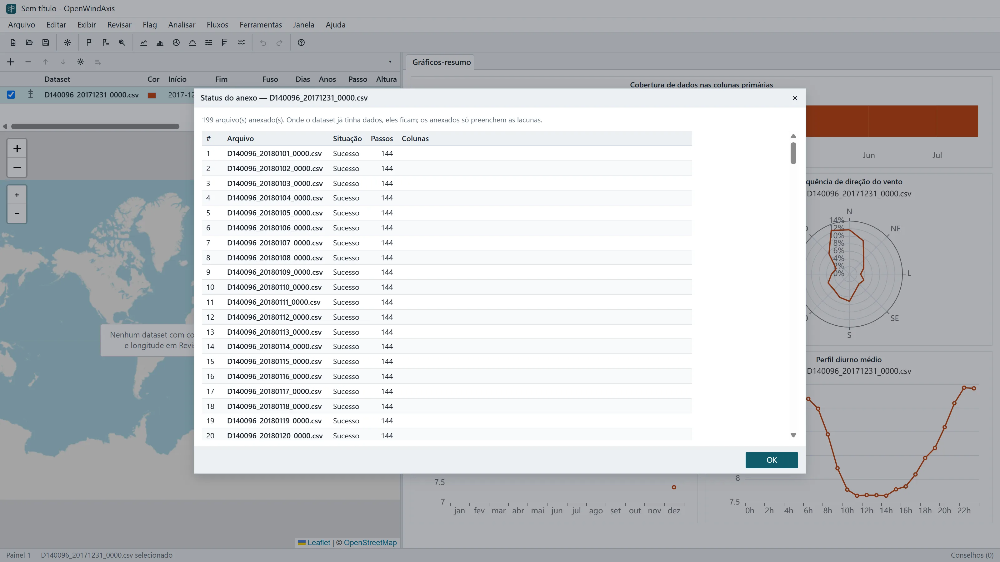

# OpenWindAxis

Análise de dados de torres anemométricas no navegador. O OpenWindAxis importa os arquivos do logger e ajuda a fazer o controle de qualidade com flags que guardam a evidência. Ele calcula as estatísticas do recurso eólico e exporta para os programas de projeto de parques. Tudo roda na sua máquina: os dados não saem do navegador.

*English: OpenWindAxis is a browser-based wind resource assessment tool. It covers met mast data import, quality control with evidence-backed flags, wind statistics (Weibull, shear, turbulence, tower shading, extremes), long-term correction (MCP) and export to WAsP, Openwind and the Brazilian EPE format. Its Rust core runs as WebAssembly in the browser and as a native CLI. The UI is in Brazilian Portuguese.*



## O que ele faz

- **Importação:**
  - CSV e TXT de qualquer logger, com detecção de separador, decimal e formato de data;
  - leitura direta dos formatos Ammonit Meteo-40 e NRG SymphoniePRO, e de reanálises NASA POWER e ERA5;
  - uma pasta inteira de arquivos diários como um só dataset, mesmo com formatos de data diferentes entre os arquivos.
- **Controle de qualidade:**
  - flag manual, por dispersão e por regras (fora da faixa, sensor travado, deriva entre anemômetros gêmeos, relógio deslocado);
  - sombra da torre pela orientação da lança ou pelo padrão detectado.
  - Cada flag guarda a evidência e pode ser desfeita; o dado medido nunca é apagado.
- **Análises:**
  - série temporal, histograma e Weibull (quatro algoritmos), rosa dos ventos, perfil diurno e cobertura;
  - cisalhamento (lei de potência e log, por mês, hora e setor), turbulência com as categorias da IEC 61400-1, distorção da torre, ventos extremos e tabelas mensais.
- **Correções:**
  - escala e offset, deslocamento de tempo, reconstrução de lacunas;
  - extrapolação vertical passo a passo;
  - ajuste de longo prazo (MCP) com oito métodos, validação mês a mês e recomendação;
  - colunas calculadas (expressões, médias, REWS, variáveis solares).
- **Exportação:** CSV, WAsP `.tab`, Openwind (MM 2.1) e o arquivo da EPE para os leilões.
- **Trabalho guardado:** o workbook (`.wproj`) guarda os arquivos, a configuração, as flags e as regras. A sessão sobrevive a um F5, e os fluxos repetem o mesmo tratamento em outras torres.
- **Ajuda:** o menu **Ajuda › Conteúdo da ajuda** (F1) percorre o tratamento de um mastro real passo a passo. Ela explica o porquê de cada etapa, com as fontes (MEASNET, NREL, IEC e a literatura de cada método).

## Como rodar

Requisitos:
- Rust estável, com o alvo `wasm32-unknown-unknown`;
- `wasm-bindgen-cli` 0.2.129;
- Node 22.

```sh
rustup target add wasm32-unknown-unknown
cargo install wasm-bindgen-cli --version 0.2.129 --locked

cd web
npm ci
npm run wasm          # compila o núcleo para WebAssembly
npm run dev           # abre em http://localhost:5173
```

`npm run build` gera a versão estática em `web/dist`, que pode ser servida por qualquer servidor de arquivos.

## A linha de comando `wind`

O mesmo núcleo e o mesmo contrato JSON do navegador, para usar em scripts e por agentes:

```sh
cargo build --release -p wind-cli
target/release/wind analyze samples/torre_exemplo.csv histogram "column=Vel 100m Média" binWidth=1
target/release/wind export samples/torre_exemplo.csv --openwind torre_openwind.csv
target/release/wind --help
```

Uma análise salva como receita (`wind recipe`) se reproduz número a número com `wind replay`, no navegador ou no terminal.

## Verificações

```sh
node bench/check.mjs                                          # testes Rust, tipos, núcleo, CLI e fórmulas
node bench/check.mjs --ui "<caminho do chrome>" http://localhost:5199/   # com o servidor de desenvolvimento na porta 5199
```

As fórmulas são conferidas contra implementações independentes (`bench/crosscheck.py`) e contra séries sintéticas de parâmetro conhecido (`samples/torre_exemplo.csv`).

## Organização

| Pasta | O que há |
|---|---|
| `crates/wind-core` | O núcleo de cálculo em Rust, sem E/S |
| `crates/wind-api` | O contrato (DTOs) entre o núcleo e quem o usa |
| `crates/wind-wasm`, `crates/wind-cli` | O núcleo no navegador e no terminal |
| `web/` | A interface em React e TypeScript |
| `docs/` | Arquitetura, roteiro, especificação da interface e o gerador da ajuda |
| `bench/` | Medições de desempenho e as verificações de ponta a ponta |

O desenho, as decisões e os critérios de desempenho estão em [docs/ARQUITETURA.md](docs/ARQUITETURA.md). Quem for contribuir, pessoa ou agente de código, encontra os comandos e as regras do projeto em [AGENTS.md](AGENTS.md).

## Sobre o original

O OpenWindAxis segue os fluxos de trabalho do Windographer, para quem já o conhece se sentir em casa. É um projeto independente, sem afiliação com a UL Solutions. Ele não usa código, textos, ícones nem a marca do Windographer: a funcionalidade é reimplementada a partir de fórmulas públicas e de normas.

## Licença

[MIT](LICENSE).
